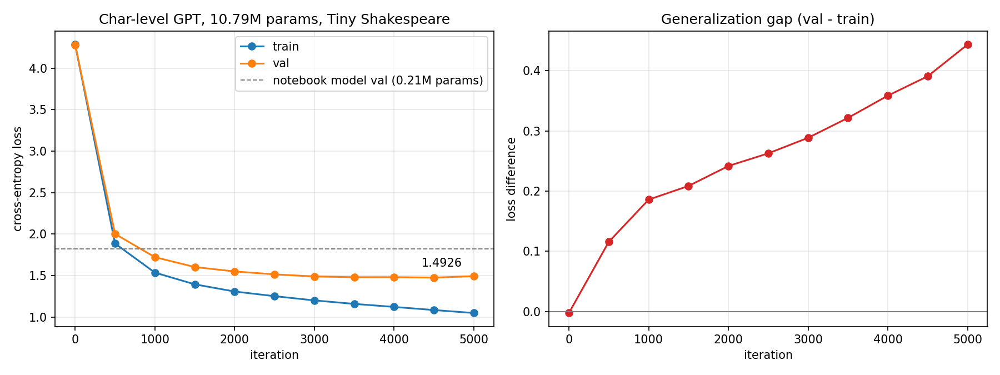

# 03 · GPT from scratch

A character-level decoder-only Transformer trained on Tiny Shakespeare, following Karpathy's [Let's build GPT](https://www.youtube.com/watch?v=kCc8FmEb1nY) lecture.

- `gpt_from_scratch.ipynb`: based on Karpathy's companion notebook for the lecture: bigram baseline, the masked-averaging trick behind self-attention, single head, scaled dot-product attention, LayerNorm, full model.
- `gpt.py`: clean script with CLI arguments: multi-head causal self-attention, ReLU feed-forward, pre-LayerNorm residual blocks, dropout, AdamW, train/val loss estimation, checkpointing and sampling.
- `experiments/v1_single_head.py`, `experiments/v2_transformer.py`: my earlier script versions, kept unchanged to show the progression. v1 has one attention head (and computes `k @ q.T` instead of `q @ k.T`); v2 is the full Transformer but does not yet apply the final LayerNorm or the dropout after the attention projection. Both are fixed in `gpt.py`.

The scripts follow the structure of Karpathy's `gpt.py` from [ng-video-lecture](https://github.com/karpathy/ng-video-lecture). Differences in `gpt.py`: no global hyperparameters, a `GPTConfig` dataclass, device auto-detection, checkpoint save/load with a `--sample-only` mode, and no custom weight initialisation.

## Run

```bash
cd 03-gpt
python gpt.py                       # default config: 6 layers, 6 heads, 384-d, block 256, 10.79M parameters
python gpt.py --max-iters 500 --n-layer 2 --n-embd 64 --n-head 4 --block-size 32 --batch-size 16   # quick run
python gpt.py --sample-only --checkpoint checkpoints/gpt.pt
```

Tiny Shakespeare is downloaded to `03-gpt/data/input.txt` on first use.

## Results

| Model | Train loss | Val loss | Hardware | Time |
|---|---|---|---|---|
| Notebook final model: 4 layers, 4 heads, 64-d, block 32, 209,729 parameters, 5,000 iterations | 1.6635 | 1.8226 | TBD | TBD |
| `gpt.py` default config: 6 layers, 6 heads, 384-d, block 256, 10.79M parameters, 5,000 iterations | 1.0489 | 1.4926 | Tesla T4 (Kaggle) | 51.5 min |

Losses are averaged over 200 batches at each evaluation (every 500 steps, plus the last step). The best validation loss was 1.4757 at step 4500. After step 3000, validation loss stopped improving (1.4894 → 1.4926) while training loss kept falling (1.2007 → 1.0489), so the gap between them grew from 0.29 to 0.44: the model starts to memorise the training text.



The full training log, with the 1000-character sample, is in [`assets/train.log`](assets/train.log), and the parsed numbers are in [`assets/results.json`](assets/results.json).

A sample from the trained model (`--max-new-tokens 1000`, excerpt):

```
HASTINGS:
And whether I take't it against the sourses
Take but and not wench, dreams on a coept.

CLARENCE:
To sweat for my dear lies a fairer.

WARWICK:
My lord, welcome, I will perceive
Whom perform'd friends, as you, sir.
```

The model has learned the format of a play (speaker names in capitals, line breaks, punctuation) and mostly real English words, but not meaning.

## What I learned

- Self-attention lets each token decide which earlier tokens to listen to: a weighted average with weights computed from the data. The `tril` mask stops it from seeing the future, and since attention has no sense of order, position embeddings are required.
- Attention and dropout were the hardest parts for me. Dropout only acts during training, which is why `model.eval()` matters before measuring loss.
- Most of my bugs were shape errors from mixing up the batch, time, channel and head dimensions. The worst bug gave no error at all: v1 computes `k @ q.T` instead of `q @ k.T`, and both have shape `(B, T, T)`, so it trains anyway.
- The small notebook model (0.21M parameters) reached 1.82 validation loss and writes much less convincing text. The 10.8M model gets to 1.49, but the gap between training and validation loss grows to 0.44: a bigger model starts to memorise the training text, and here the best checkpoint would have been around step 4500, not the last one.
